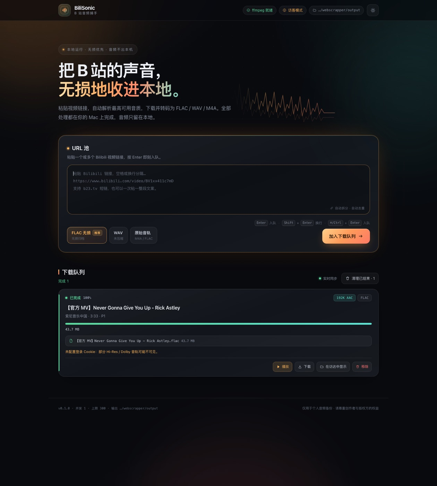

# BiliSonic · B 站音频捕手

一个运行在本地 Mac 上的 B 站音频下载器：粘贴视频链接，自动解析**当前账号/当前 URL 可见的最高音质音轨**，流式下载后用 ffmpeg 转成 FLAC / WAV / 原始音轨，并按视频标题保存到同一个文件夹。

- 图形化 Web UI（FastAPI + 原生 HTML/CSS/JS，无前端构建、无 Electron、无 CDN）
- 粘贴 → Enter 入队；支持一次粘贴多条链接、短链、BV 号
- 下载 / 转码实时进度、速度、ETA；SSE 推送 + 轮询兜底
- 官方 Bilibili API 主解析 + yt-dlp 兼容兜底，接口变化时不会直接瘫痪
- 默认 FLAC 无损封装；可选 WAV（PCM）与“原始音轨不转码”
- 单进程、单任务并发（可调），内存占用平稳；适配 16 GB MacBook Air
- 全部在 `127.0.0.1` 本地运行，无遥测、无云端上传



> **关于“无损”的诚实说明**：B 站绝大多数视频最高只提供 **192 kbps AAC（有损）**。把它转成 FLAC 是“无损封装”，不会把丢失的细节变回来。只有部分视频提供 **Hi-Res FLAC / Dolby**，且通常需要登录 Cookie。BiliSonic 会按 `Hi-Res 无损 → Dolby → 最高码率 AAC` 排序，并尽力获取当前账号可见的最好一档；失败时才降级，且会在任务里明确标注。

---

## 1. 快速开始（macOS）

环境要求：macOS 12+（Apple Silicon 原生）、Python 3.10+、ffmpeg。项目只在本地监听 `127.0.0.1`。

```bash
brew install ffmpeg                 # 必需：转码/封装
cd webscrapper
./setup.sh                          # 创建 .venv 并安装依赖（含 yt-dlp）
./run.sh                            # 启动，自动打开 http://127.0.0.1:8765
```

不想用脚本时：

```bash
python3 -m venv .venv
source .venv/bin/activate
pip install -e '.[dev]'
python -m bili_audio               # 等价于监听 127.0.0.1:8765
```

国内网络下 PyPI 官方源可能很慢，可先设置镜像：

```bash
PIP_INDEX_URL=https://pypi.tuna.tsinghua.edu.cn/simple ./setup.sh
```

首次启动会创建 `output/`（可在 `.env` 中改路径）。Ctrl+C 停止服务，最多等待当前任务安全退出。

### 登录 Cookie（可选，但想要 Hi-Res 时通常必需）

B 站对部分高音质音轨做账号校验。任选一种方式配置，**不要把 Cookie 提交到 Git 或发给别人**：

```bash
cp .env.example .env
# 方式 A：只填 SESSDATA（推荐，权限最小）
BILI_SESSDATA=你的SESSDATA

# 方式 B：完整 Cookie 头（从浏览器 DevTools → Application → Cookies 复制）
BILI_COOKIE=SESSDATA=...; bili_jct=...; buvid3=...

# 方式 C：浏览器导出的 Netscape cookies.txt
BILI_COOKIE_FILE=/Users/you/cookies.txt
```

修改后重启服务。UI 顶部会显示“Cookie 已配置 / 访客模式”。Cookie 仅保存在进程内存中，不会写入任务记录，也不会发送给 B 站 CDN 域名。

---

## 2. 使用方式

1. 打开 UI，把视频链接粘贴进 **URL 池**：
   - 支持 `https://www.bilibili.com/video/BV...`、`av...`、`b23.tv/...`、`bili2233.cn/...`、番剧页（走 yt-dlp）
   - 支持一次粘贴多行/一段包含多个链接的文字，自动拆分去重
   - 直接粘贴 `BV1xxxxxxxxx` 这样的 BV 号也可以
2. 按 **Enter** 或点“加入下载队列”。`Shift+Enter` 换行，`⌘/Ctrl+Enter` 也可以提交。
3. 任务卡会依次显示：解析视频信息 → 选择最佳音轨 → 下载 → 转换/封装 → 完成。
4. 完成后可以：
   - **播放**：浏览器内直接试听
   - **下载**：把生成的文件另存到别处
   - **在访达中显示**：打开输出目录并选中文件
   - **移除**：只移除界面记录，不会删除已生成的音频文件
5. 右上角可切换深/浅色；格式在提交前选择，默认 `FLAC 无损`。

输出目录默认是仓库下的 `output/`，文件名来自视频标题；分 P 视频会追加 ` - P2`。重名自动加 ` (2)`、` (3)`，不会覆盖已有文件。

### 输出格式怎么选

| 选项 | 行为 | 适用场景 |
|---|---|---|
| **FLAC 无损**（推荐） | Hi-Res FLAC 重新无损编码；AAC 源无损封装 | 兼容性好，适合存档；AAC 源会变大但不提升音质 |
| **WAV 无损** | 解码为 PCM；无损源用 24bit，AAC 源用 16bit | 音频再编辑、DAW 导入；体积最大 |
| **原始音轨** | AAC 直接 copy 成 `.m4a`；Hi-Res 直接保留 `.flac` | 体积最小、零二次转码；播放器需支持 FLAC/M4A |

---

## 3. 音质选择策略（核心逻辑）

解析顺序固定，并由 `src/bili_audio/quality.py` 统一实现：

1. **Hi-Res 无损 FLAC**（`dash.flac.audio`，id 30251）
2. **Dolby Atmos**（`dash.dolby.audio`，id 30250）
3. **最高带宽的常规 AAC**（通常 30280 / 192 kbps；同档取 `bandwidth` 最大）
4. **兼容模式**：极老稿件只返回音视频混合流（`durl`）时，下载后抽取音轨

没有“假装无损”的逻辑：FLAC 目标始终可用，但源是有损时 UI 会明确提示“转为 FLAC 不会提升原音质”。如果最佳音轨下载失败，会依次尝试下一档，并在任务 warnings 里记录降级。所有候选都失败时会保留失败原因，可一键重试（重试会重新解析，拿到新的 CDN 链接）。

---

## 4. 常用命令

```bash
./run.sh                          # 启动 Web UI
./run.sh doctor                   # 体检：ffmpeg / 目录 / Cookie / B 站接口契约
./run.sh doctor --offline         # 只用本地 fixture 做契约测试
./run.sh doctor --url 'https://www.bilibili.com/video/BV...'
./run.sh doctor --strict           # warning 也返回非 0，适合 CI 监控
./run.sh --port 9000 --no-browser # 指定端口、不自动开浏览器
./run.sh --output-dir ~/Music/B站  # 指定输出目录
make test                         # 运行测试
make fixtures                     # 刷新脱敏接口 fixture（维护用）
```

`doctor` 会区分“本机问题”和“B 站上游变化”，是接口失效时的第一排查入口。详见 [MAINTENANCE.md](MAINTENANCE.md)。

---

## 5. 配置项（`.env`）

| 变量 | 默认值 | 说明 |
|---|---|---|
| `BILI_OUTPUT_DIR` | `./output` | 音频输出目录 |
| `BILI_HOST` | `127.0.0.1` | 监听地址；改成 `0.0.0.0` 前请理解无认证风险 |
| `BILI_PORT` | `8765` | 端口；被占用时自动顺延 |
| `BILI_AUDIO_FORMAT` | `flac` | 默认格式：`flac` / `wav` / `m4a` |
| `BILI_MAX_CONCURRENT` | `1` | 同时处理任务数（1–4）；Air 建议 1 |
| `BILI_MAX_TASKS` | `300` | 内存中任务记录上限 |
| `BILI_DOWNLOAD_RETRIES` | `3` | 单个候选 URL 的重试次数；之后才考虑降级 |
| `BILI_SESSDATA` / `BILI_COOKIE` / `BILI_COOKIE_FILE` | 空 | 登录凭据（见上） |
| `BILI_PROXY` | 空 | 可选 HTTP 代理，如 `http://127.0.0.1:7890` |
| `BILI_FFMPEG` / `BILI_FFPROBE` | `ffmpeg` / `ffprobe` | 自定义二进制路径 |
| `BILI_CONVERT_TIMEOUT` | `900` | 单次转换超时（秒） |
| `BILI_LOG_LEVEL` | `INFO` | `DEBUG` / `INFO` / `WARNING` / `ERROR` |

命令行参数可临时覆盖 `host/port/output-dir/format/concurrency`。

---

## 6. 技术结构

```text
web/                         原生 HTML / CSS / JS（无构建步骤）
src/bili_audio/
  __main__.py                CLI：serve / doctor
  server.py                  FastAPI 路由、SSE、静态 UI、安全响应头
  tasks.py                   内存队列 + 任务状态机 + 流水线编排 + 事件总线
  extractors/
    __init__.py              解析链：官方 API → yt-dlp 兜底
    bilibili.py              官方 view/playurl 解析、错误码翻译、契约校验
    ytdlp.py                 yt-dlp 兼容解析（含番剧），只取 URL 不下载
  quality.py                 音轨模型、排序策略、诚实音质说明
  downloader.py               httpx 流式下载、Range 续传、备用 CDN、取消
  converter.py                ffmpeg 探测/转码/progress 解析/超时与清理
  naming.py                   文件名清洗、UTF-8 字节限制、重名处理
  urls.py                     仅允许 B 站域名的 URL 解析与 canonical key
  diagnostics.py             doctor 检查项
tests/                       单元 + 契约 + 下载/转码 + 队列 + API 集成测试
tests/fixtures/              脱敏后的 B 站响应快照（契约回归）
scripts/update_fixtures.py   刷新 fixture 的维护脚本
```

**处理流程**：URL 解析 → 官方 API（失败时 yt-dlp）→ 音轨排序 → httpx 流式下载到 `output/.work/` → ffmpeg 转换 → `os.replace()` 原子移动到 `output/`。下载和转换都在单个 asyncio 进程内完成，不把整段音频读入内存；默认并发 1，典型内存几十 MB，空闲时更低。

### HTTP API（UI 自用，也可脚本调用）

| 方法 | 路径 | 说明 |
|---|---|---|
| GET | `/api/meta` | 版本、输出目录、ffmpeg、Cookie、格式、并发等 |
| GET | `/api/tasks` | `{tasks, stats}` |
| POST | `/api/tasks` | `{url, format?}` → `{task}`（201） |
| GET | `/api/tasks/{id}` | 单任务 |
| DELETE | `/api/tasks/{id}` | 移除记录（运行中 409） |
| POST | `/api/tasks/{id}/cancel` | 取消 |
| POST | `/api/tasks/{id}/retry` | 重试失败/已取消 |
| POST | `/api/tasks/clear` | 清理已结束记录 |
| GET | `/api/tasks/{id}/audio` | 播放；`?download=1` 强制下载 |
| POST | `/api/reveal` | 在访达中显示输出目录/文件 |
| GET | `/api/events` | SSE：`task` / `deleted` / `snapshot` |

API 文档运行时在 `http://127.0.0.1:8765/api/docs`。

---

## 7. 开发与测试

```bash
source .venv/bin/activate
pytest -q
python -m bili_audio doctor --offline
python -m bili_audio doctor          # 会访问 B 站（只读，不下载）
```

测试覆盖：URL 解析/域名白名单、音轨排序、脱敏 fixture 契约、API 错误码、下载器（Range/备用 URL/HTML 风控）、ffmpeg 转码、文件名安全、队列/取消/重试/重名、FastAPI 生命周期与媒体路由。需要联网的只有 `doctor` 在线检查和手工端到端验证；`pytest` 全部离线。

提交前建议：

```bash
pytest -q && ./run.sh doctor --offline
```

版本管理：Git；`.venv/`、`output/`、`.env` 均已忽略。首次提交前确认没有 Cookie 或媒体文件进入暂存区。

---

## 8. 故障排查

| 现象 | 处理 |
|---|---|
| UI 打不开 / 端口被占用 | 终端看实际端口（自动顺延）；或 `./run.sh --port 9000` |
| “ffmpeg 未就绪” | `brew install ffmpeg`，或在 `.env` 指定 `BILI_FFMPEG` |
| 只有 64K/132K，没有 192K | 未登录时 B 站可能降级；配置 `BILI_SESSDATA` 后重试 |
| 没有 Hi-Res FLAC | 视频本身没有 Hi-Res，或账号无权限；不是所有视频都有无损 |
| 412 / 风控校验失败 | 稍后重试；配置 Cookie；避免频繁批量请求 |
| 浏览器报 403 “非法的 Host 请求头” | 请用 `http://127.0.0.1:8765` 或 `http://localhost:8765` 访问，不要用自定义域名反代到本机 |
| 媒体链接已过期 / 403 | 点重试，程序会重新解析拿新链接 |
| 下载完成但播放器不识别 | 选 FLAC 或 WAV；极老兼容模式源可能是 MP4 容器抽出的 AAC |
| 内存/CPU 高 | 保持 `BILI_MAX_CONCURRENT=1`；关闭其他 ffmpeg 任务 |
| 想彻底重置 | 删除 `output/.work/`；已完成文件在 `output/` 不会被删 |

更多维护流程见 [MAINTENANCE.md](MAINTENANCE.md)。

## 9. 隐私、安全与限制

- 服务默认只绑定 `127.0.0.1`，没有登录认证。**不要**在不可信网络把 `BILI_HOST` 改为 `0.0.0.0`。
- 校验 `Host` 与跨站 `Origin`，阻止 DNS rebinding / 网页 CSRF（`curl` 等本机脚本不受影响）。
- 只接受 B 站域名，URL 白名单防止被当作任意 URL 代理（SSRF）。
- Cookie 只存内存；日志会对 Cookie 值脱敏；媒体 CDN 请求不带 Cookie。
- 文件名经过清洗且限制 UTF-8 字节长度，防止路径穿越和 macOS 文件名超限。
- 队列状态在内存中，重启后清空；已生成文件保留。若需要长期历史，可按 README 的 API 自行落库。
- 仅支持 B 站；不提供去 DRM、破解付费/地区限制的能力。请遵守 B 站条款和版权规定，仅下载你有权保存的内容。
